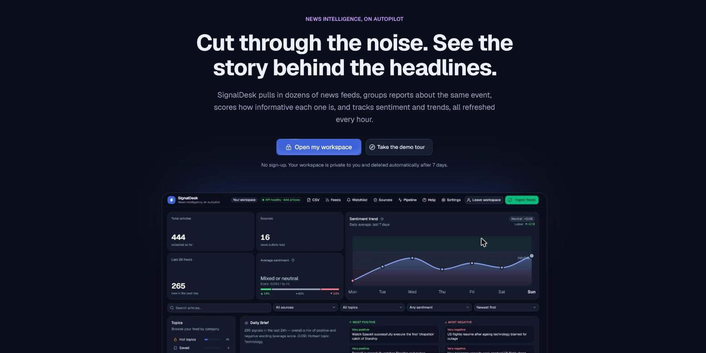
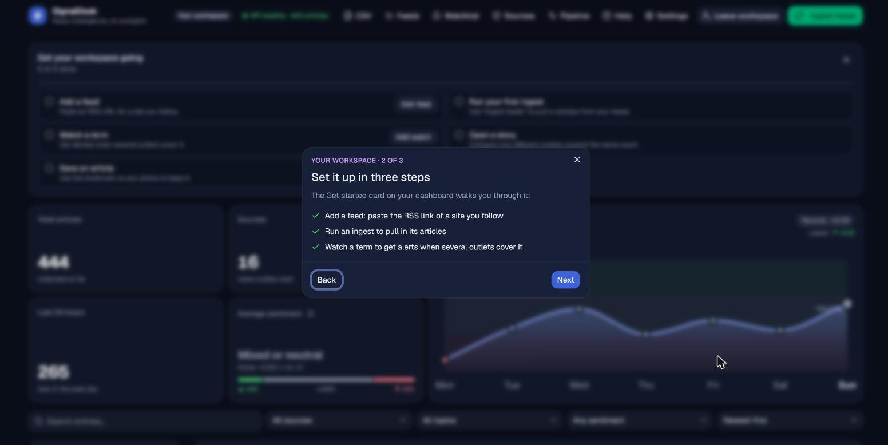
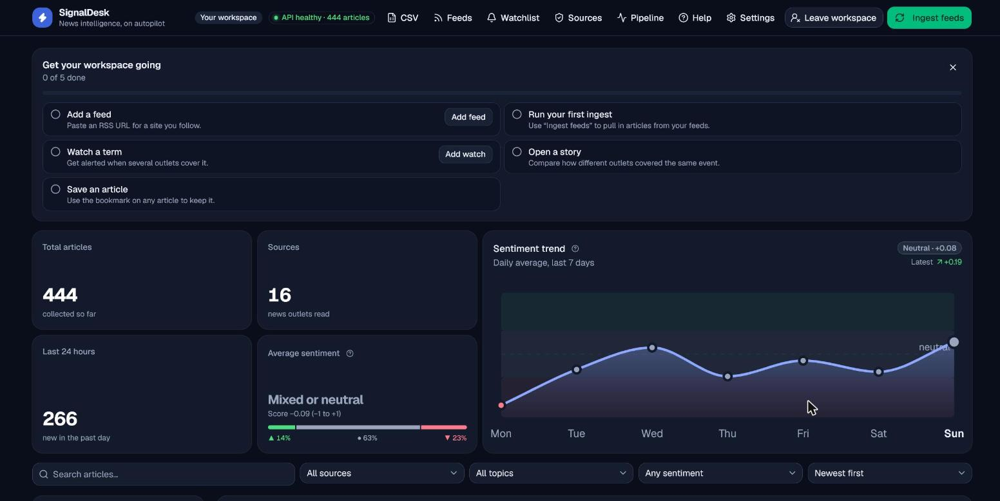
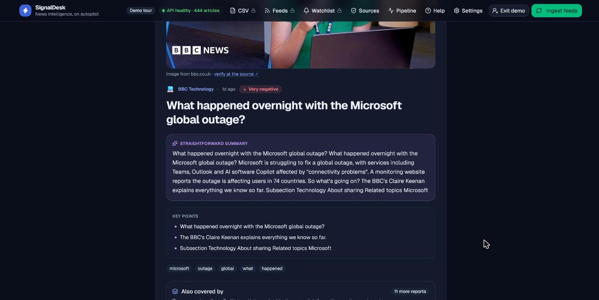
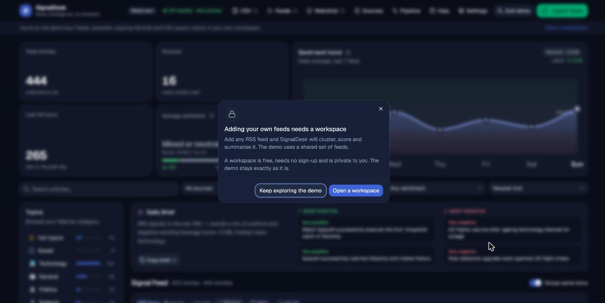
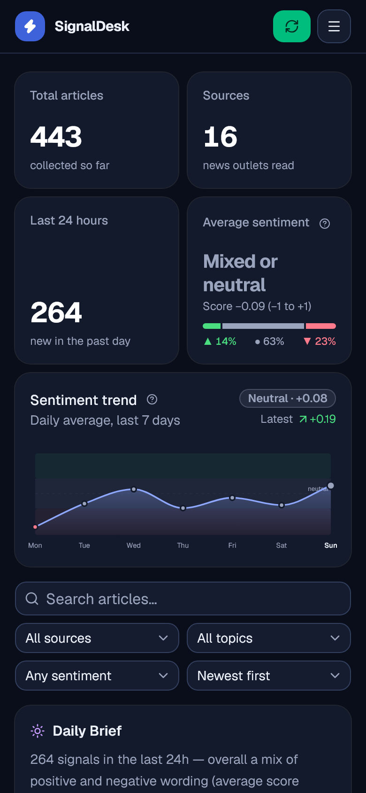
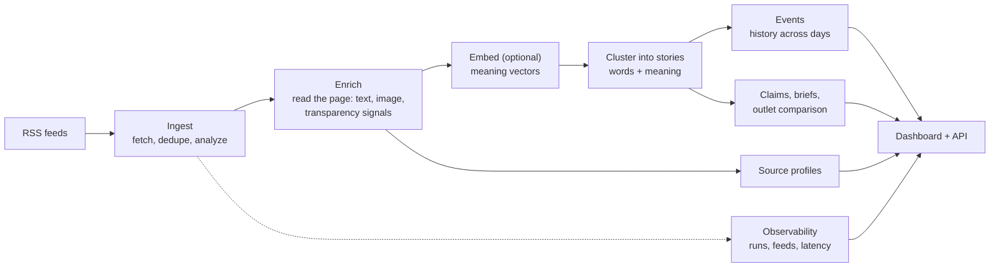

# ⚡ SignalDesk

> **News intelligence, on autopilot.** SignalDesk reads dozens of news feeds, groups the reports that cover the same event, shows what outlets agree and disagree on, and tells you how healthy its own pipeline is.

[](https://github.com/ShervinBabaei2007/SignalDesk/actions/workflows/ci.yml)    

## A quick tour

**1. Landing page.** Open a private workspace, or take the demo tour. No sign-up.



**2. Welcome dialog.** Each mode starts with a short guide to what you can do there.



**3. Get started checklist.** Add a feed, run an ingest, watch a term, open a story and save an article. Steps tick off as you go.



**4. Dashboard.** Key figures, a seven-day sentiment trend, topics, the daily brief and the story feed. A workspace can copy or download the brief.


**5. Story page.** Reports of one event are grouped. See what every outlet agrees on, where they differ, and claim-by-claim comparison.


**6. Article reader.** A plain summary, key points, a sentiment label and the other outlets covering the same story.



**7. Demo limits.** The demo shows feeds, watchlist, brief copying and CSV export locked, and offers a workspace where they unlock.



**8. On a phone.** The whole app works on mobile.



## How it works



Everything works **offline with no API keys**. A language model and an embeddings endpoint are optional upgrades, and every one of them falls back cleanly when missing or failing.

## Features

| Area | What you get |
|------|--------------|
| **Semantic story clustering** | Reports of one event are grouped by headline wording *and*, when embeddings are configured, by meaning, so paraphrases with no shared words still land in one story. A guard splits chained mega-stories. |
| **Claim-level comparison** | For each story: which factual claims several outlets **agree** on, which are **disputed** (two outlets give different figures, shown side by side) and which only one outlet makes. |
| **Historical event tracking** | A durable event identity follows a story across days and shows how coverage developed: reports per day, which outlets joined when, who was first, and how the tone shifted. |
| **Source reliability analysis** | An explainable per-outlet profile: transparency (bylines, dates, linked sources, corrections link), corrections practice, information quality, corroboration, claim agreement and feed availability. It shows its working and withholds a score when evidence is thin. It describes how an outlet publishes, **not whether it is right**. |
| **Pipeline observability** | Every ingest cycle and every feed is recorded: failures, p50/p95 latency, throughput, page-read success rate and backlog. A dead feed is a failure, not "0 new articles". |
| **Reading experience** | Information score per report, AI or offline story briefs, article reader with key points and quotes, hot topics, watchlist alerts, saved articles, light and dark themes, mobile-first UI. |
| **Demo and private workspaces** | A guided demo tour at `/demo` on the shared data, and a private workspace at `/workspace` with your own feeds and watchlist, invisible to everyone else. Both start with a welcome dialog and a "Get started" checklist. |
| **Platform** | SQLite by default, PostgreSQL with one variable, automatic migrations, scheduler, Slack/email digest, CSV export, Docker, GitHub Actions CI. |

## Quick start

Requires **Python 3.12+** and **Node 22.22+** (React Router 8 needs it).

```bash
git clone https://github.com/ShervinBabaei2007/SignalDesk.git && cd SignalDesk
python -m venv .venv
.venv\Scripts\pip install -r backend/requirements.txt        # macOS/Linux: source .venv/bin/activate && pip install -r backend/requirements.txt
cd frontend && npm install && npm run build && cd ..          # build the dashboard once
cd backend && ..\.venv\Scripts\python -m uvicorn app.main:app --reload
```

Open <http://localhost:8000>. The database creates and seeds itself on first boot; API docs are at `/docs`. For UI work run `npm run dev` in `frontend/` (http://localhost:5173), with the backend running on port 8000 because Vite proxies `/api` to it. Without the backend the landing page can't tell that workspaces are enabled and falls back to "Try as a demo".

**Docker:** `docker compose up --build` serves everything on port 8000 and keeps data in a volume. Copy `.env.example` to `.env` to configure it.

## Routes and modes

The app uses [React Router](https://reactrouter.com) (library mode) with real URLs.

| Path | What it is |
|------|------------|
| `/` | The dashboard for browsing read-only or as the owner. First-time visitors are sent to `/welcome`. |
| `/welcome` | Landing page with "Open my workspace" and "Take the demo tour". |
| `/demo`, `/demo/article/:id`, `/demo/story/:id` | The demo tour: starts a short-lived demo session, then shows the app with a few features locked. |
| `/workspace`, `/workspace/article/:id`, `/workspace/story/:id` | Your private workspace: starts or resumes your workspace session. Redirects to `/welcome` when workspaces are off. |
| `/article/:id`, `/story/:id` | Unprefixed pages; a demo or workspace visitor is redirected under their prefix. |

Old `/#/article/5` style links still work: they redirect to the real path. Every unknown path shows a "Page not found" page, and the backend serves `index.html` for client routes so refreshing a deep link works.

**Demo vs. workspace.** The demo keeps the dashboard, stories, reader, filters, live ingest, source profiles and pipeline health. It shows four features locked, with a prompt that offers a workspace: your own feeds, the watchlist and alerts, copying the daily brief, and CSV export. In a workspace nothing is locked. A workspace has no delivery channel of its own, so it copies or downloads the brief as text. Sending to Slack or email stays owner-only.

## Configuration

Everything is an environment variable (see [`.env.example`](.env.example)); nothing below is required to run.

| Variable | Default | Purpose |
|----------|---------|---------|
| `DATABASE_URL` | SQLite file | Use `postgresql://…` in production |
| `APP_ENV`, `CORS_ORIGINS`, `LOG_LEVEL` | `development`, `*`, `INFO` | Set explicit origins in production |
| `INGEST_INTERVAL_MINUTES` / `INGEST_COOLDOWN_SECONDS` | `15` / `20` | Scheduler interval (`0` disables) and the manual-ingest cooldown |
| `MAX_ARTICLE_AGE_DAYS`, `ENRICH_BATCH_SIZE`, `SCHEDULER_DISABLED` | `7`, `30`, `false` | Ingest window, enrichment wave size, off switch for tests/serverless |
| `API_TOKEN` | unset | Required as `X-API-Key` on owner-only writes |
| `LLM_ENABLED`, `LLM_API_KEY`, `LLM_BASE_URL`, `LLM_MODEL` | off | Written briefs and claim extraction via any OpenAI-compatible API (OpenAI, Ollama, LM Studio…) |
| `EMBEDDINGS_ENABLED`, `EMBEDDING_MODEL` | off, `text-embedding-3-small` | Semantic clustering. Base URL and key default to the `LLM_*` ones (`EMBEDDING_BASE_URL`, `EMBEDDING_API_KEY` override) |
| `EMBEDDING_DIMENSIONS`, `EMBED_SIM_MIN` | `256`, `0.78` | Vector size (smaller is cheaper) and the cosine threshold for "same event". Tune per model |
| `SESSION_SECRET`, `WORKSPACE_TTL_DAYS`, `WORKSPACE_MAX_*`, `WORKSPACE_CREATES_PER_HOUR` | `API_TOKEN`, `7`, `8/10/600`, `20` | Private workspaces: signing key, expiry and per-visitor limits. Off when no secret is set |
| `DEMO_MODE`, `DEMO_TTL_SECONDS` | off, `7200` | The read-and-ingest demo tour |
| `SLACK_WEBHOOK_URL`, `DIGEST_EMAILS`, `SMTP_*`, `DIGEST_HOUR` | unset | Daily brief and alert delivery |
| `CRON_SECRET` | unset | Bearer secret for `/api/cron/ingest` |

## API

Interactive docs at `/docs`. The main endpoints:

| Endpoint | Description |
|----------|-------------|
| `GET /api/stories`, `/api/stories/{id}` | Grouped feed; one story with brief, **claims**, outlet comparison (with source scores) and ranked reports |
| `GET /api/stories/{id}/timeline` | Day-by-day coverage of the story's event |
| `GET /api/sources` | Evidence-based outlet profiles with the score breakdown |
| `GET /api/observability?hours=24` | Pipeline health: runs, latency, throughput, failing feeds, extraction rate, backlog |
| `GET /api/articles`, `/api/articles/{id}` | Search, filter, sort, paginate; article detail with related coverage |
| `GET /api/trending`, `/api/digest`, `/api/stats` | Hot stories (with days active), daily brief, KPIs and 7-day trend |
| `GET/POST/DELETE /api/feeds`, `GET/POST/PATCH/DELETE /api/watches` | Feeds and watchlist (scoped to the caller's workspace) |
| `POST /api/ingest` | Fetch feeds, analyze, store, check watches |
| `POST /api/workspace`, `DELETE /api/workspace` | Open or reset a private workspace |
| `GET /api/health`, `/api/articles/export.csv` | Liveness; full CSV export |

## Deploy on Vercel

1. Add a Postgres database (Vercel Storage, Marketplace, Neon). It sets `DATABASE_URL`.
2. Set `APP_ENV=production`, `SCHEDULER_DISABLED=true`, `API_TOKEN`, `CRON_SECRET` (random strings) and `CORS_ORIGINS` (your URL). Optionally `DEMO_MODE=true`, plus `LLM_*` and `EMBEDDINGS_ENABLED=true` for the AI upgrades.
3. `vercel --prod`. `vercel.json` deploys the FastAPI `backend` and Vite `frontend` as two services on one domain. After the first deploy, refresh a deep link such as `/demo` or `/workspace/story/1` to confirm the frontend service falls back to `index.html`.
4. Hobby plans allow only a daily cron, so `.github/workflows/ingest.yml` calls `/api/cron/ingest` every 15 minutes. Add the repository secrets `APP_URL` and `CRON_SECRET`.

**Upgrading an existing database.** Schema changes are additive columns and tables, applied automatically on boot. The one exception: feed names/URLs and article URLs become unique **per workspace** instead of globally. SQLite tables are rebuilt in place (rows kept); on PostgreSQL the old unique constraints are dropped and composite unique indexes created. It is idempotent, but **back up a production database before the first deploy**.

## Security and privacy model

- **Shared vs. private.** Cron-ingested news is shared; a visitor's feeds, watches and articles carry a signed workspace id and are invisible to others. A story that includes a visitor's article is never cached for anyone else.
- **Strangers can add feed URLs**, so fetches go through an SSRF guard (public http(s) only, every redirect checked, responses size-capped), each workspace has caps, and workspace creation is rate-limited per IP.
- **Owner-only:** Slack/email delivery (workspaces copy or download the brief instead), recommended-feed reset and refreshing briefs. A visitor's articles never reach an LLM or embeddings API, so visitors cannot spend your quota.
- **Source profiles** use only shared data, so a visitor cannot influence a public score.
- The real `API_TOKEN` is never handed out; workspace and demo tokens are signed with a derived key and cannot act as it.

## Operating it

Open **Pipeline** in the header (or `GET /api/observability`). Healthy looks like: a last good run under ~15 minutes ago, near-100% of cycles succeeding, no failing feeds and a page-read rate that stays steady. Investigate when the last good run is older than an hour (the scheduler or cron stopped), a feed's failure rate climbs (dead URL or blocking), or the page-read rate drops (a site changed its markup or started blocking). Each cycle also logs one line: `[pipeline] kind=scheduled duration_ms=… feeds_failed=… added=…`. Run history is kept 30 days.

## Testing

```bash
.venv\Scripts\python -m pytest -q          # backend
cd frontend && npm run typecheck && npm test && npm run build
```

CI runs both on every push. Tests use fakes for the network, the LLM and the embeddings provider, so they are hermetic.

## Project structure

```
backend/app/
  main.py            routes, auth, workspace scoping     ingestion.py, pipeline.py   fetch, cycle, enrichment backlog
  clustering.py      words + meaning clustering          embeddings.py               optional vectors
  claims.py          claim comparison                    briefs.py, llm.py           story briefs, optional model
  events.py          event history and timelines         reliability.py, signals.py  source profiles, page signals
  observability.py   run history and health summary      workspace.py, netguard.py   private workspaces, SSRF guard
frontend/src/        React + Vite + TypeScript + Tailwind + shadcn/ui
  router.tsx         route table: /welcome, /demo, /workspace and the unprefixed pages
  lib/mode.ts        demo and workspace prefixes, locked features
  lib/nav.ts         navigation and header events from outside components
  lib/onboarding.ts  welcome dialog and checklist state, per mode
  components/app/    dashboard, story page, claims/timeline cards, sources and pipeline dialogs, onboarding
backend/tests/       pytest suites per module
```

## Limitations and roadmap

- **Claim matching is lexical** (sentence word overlap plus figure comparison). It catches conflicting numbers well and paraphrased prose less well; the LLM path is better. Embeddings are per headline, not per sentence.
- **Source profiles need data.** Transparency signals are read from article pages, so a profile appears after a few readable pages per outlet. Scores describe observable publishing practice, are a heuristic, and say nothing about correctness. Corroboration looks at the last few days only.
- **Events follow a story while consecutive windows overlap**; a silence longer than 48 hours between reports starts a new event.
- **Embedding thresholds** (`EMBED_SIM_MIN`) are model-specific and should be tuned on your own feeds.
- In-memory rate limits and cooldowns are per instance, so best-effort on serverless.
- Next: sentence-level embeddings for claims, per-topic source profiles, and alert routing per workspace.

## License

MIT. See [MIT-LICENSE.txt](MIT-LICENSE.txt).
