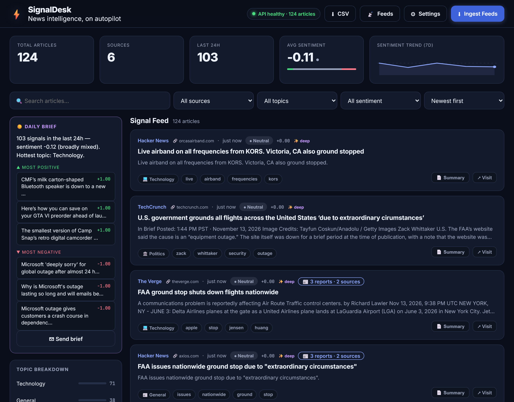
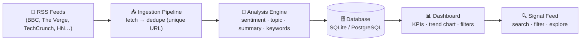

# ⚡ SignalDesk

> **AI-powered news intelligence, on autopilot.**
> SignalDesk pulls news from RSS feeds around the web, deduplicates it, scores sentiment, classifies topics, and surfaces it all in a real-time intelligence dashboard.

    

---



---

## What it does



Every article that enters the system is automatically:

- **Scored for sentiment** in `[-1.0, +1.0]` with negation and intensifier handling
- **Classified** into one of 6 topics (Technology, Business, Science, Politics, Health, World)
- **Summarized** with an extractive summary
- **Tagged** with extracted keywords
- **Deduplicated** by URL, so re-running ingestion never creates duplicates

And the platform runs itself: a built-in scheduler re-ingests every feed every 30 minutes — no cron, no external workers.

## Highlights

| | |
|---|---|
| 📡 **Live RSS ingestion** | Pull from any RSS feed with one click — 110 real articles in under 2 seconds |
| 🤖 **Auto-pilot scheduler** | Background task re-fetches every feed on a configurable interval; feeds report health status ("ok: 5 added · 2h ago") |
| 📄 **Full-text summaries** | Each article's external link is fetched and parsed into a skimmable brief — TL;DR, key points, key numbers, quotes, and bottom line — so you get 90% of the story without opening the site |
| 📖 **Article reader page** | Clicking an article opens a dedicated reader at `/#/article/{id}` with the straightforward summary up top and the full extracted article text below — much nicer than the raw site |
| 🧠 **Zero-dependency NLP** | Deterministic lexicon-based analysis that works offline; clean interface for swapping in an LLM later |
| ☀️ **Daily Brief** | Auto-generated intelligence headline + most positive/negative signals, refreshed with the stats |
| 📊 **Intelligence dashboard** | Dark-mode UI: KPI cards, 7-day sentiment trend, topic breakdown, keyword chips, article detail modal with sentiment gauge |
| 🔍 **Search, filter & sort** | Live search, source/topic/sentiment filters, newest/oldest/most-polarized sorting, and "load more" pagination |
| 📤 **CSV export** | One click exports the full article dataset |
| 🗄️ **Zero-config persistence** | SQLite by default, PostgreSQL with one environment variable; automatic column migrations on startup |
| 🌱 **Real-article seeding** | First boot ingests the real default feeds so every article has a genuine URL; built-in sample articles are only used when the network is unreachable |
| ✅ **Tested** | 31 pytest tests covering the extractor, analysis engine, API surface, sorting, digest, and export |
| 🐳 **One-container deploy** | `docker compose up --build` and you're done |

## Quick start

```bash
git clone https://github.com/<you>/SignalDesk.git
cd SignalDesk

# 1. Install dependencies
python -m venv .venv
.venv\Scripts\pip install -r backend/requirements.txt   # Windows
# source .venv/bin/activate && pip install -r backend/requirements.txt  # macOS/Linux

# 2. Run the server
cd backend
..\.venv\Scripts\python -m uvicorn app.main:app --reload

# 3. Open the dashboard
start http://localhost:8000
```

That's it — the database creates and seeds itself on first boot. No config files, no API keys, no external services.

### Docker

```bash
docker compose up --build
# → http://localhost:8000
```

## The dashboard

Open **http://localhost:8000** to get:

- **KPI row** — total articles, sources, last-24h volume, average sentiment, sentiment split
- **7-day sentiment trend** — SVG sparkline of daily average sentiment
- **Topic breakdown** — clickable topic distribution bars
- **Signal Feed** — every article with sentiment badge, score, topic chip, clean full-text summary, and 📄 Summary / ↗ Visit actions
- **Article reader** — clicking any article opens a distraction-free reader page with the summary and the full article text
- **Filters** — live search, source, topic, and sentiment filters
- **📡 Feeds manager** — add/remove RSS feeds from the UI
- **⬇ Ingest Feeds** — one-click pipeline run with a live results report

Interactive API docs live at **http://localhost:8000/docs** (Swagger UI).

## API

| Method | Endpoint | Description |
|--------|----------|-------------|
| `GET` | `/api/health` | Service health + row counts |
| `GET` | `/api/stats` | KPIs, sentiment split, topic breakdown, 7-day trend |
| `GET` | `/api/digest` | Generated daily brief: headline, extremes, topic counts |
| `GET` | `/api/articles` | Search/filter/sort/paginate articles |
| `GET` | `/api/articles/{id}` | Article detail (incl. keywords) |
| `POST` | `/api/articles/{id}/summarize` | Fetch the linked page and generate a clean full-text summary on demand |
| `GET` | `/api/articles/export.csv` | Download all articles as CSV |
| `GET` | `/api/feeds` | List feeds with last-fetch health |
| `POST` | `/api/feeds` | Add a feed (`{"name", "url"}`) |
| `DELETE` | `/api/feeds/{id}` | Remove a feed |
| `POST` | `/api/ingest` | Fetch all active feeds → dedupe → analyze → store |

## Configuration

| Variable | Default | Purpose |
|----------|---------|---------|
| `DATABASE_URL` | SQLite (`backend/signaldesk.db`) | Point at PostgreSQL for production |
| `INGEST_INTERVAL_MINUTES` | `30` | Auto-pilot re-ingest interval; `0` disables the scheduler |

## Project structure

```
SignalDesk/
├── backend/
│   ├── app/
│   │   ├── main.py          # FastAPI app, routes, static serving
│   │   ├── database.py      # Engine + sessions (SQLite → Postgres switchable)
│   │   ├── models.py        # SQLAlchemy models (Article, Feed)
│   │   ├── schemas.py       # Pydantic request/response schemas
│   │   ├── analysis.py      # Sentiment · topics · summary · keywords
│   │   ├── ingestion.py     # RSS fetch → dedupe → analyze → store
│   │   └── seed_data.py     # Demo data auto-seeded on first boot
│   └── tests/               # pytest: analysis unit tests + API integration
├── frontend/                # Zero-build dashboard (vanilla HTML/CSS/JS)
│   ├── index.html
│   ├── styles.css
│   └── app.js
├── Dockerfile
├── docker-compose.yml
└── pytest.ini
```

## Design decisions

- **Deterministic NLP over LLM-by-default.** The lexicon-based analyzer runs offline, is instant, and behaves identically on every demo run — ideal for a showcase. The `analyze()` interface is a single function, so dropping in an OpenAI/Anthropic-backed implementation is a one-file change.
- **Deduplication at the storage layer.** URLs are unique-indexed; ingestion is idempotent, so the pipeline can run on a schedule without supervision.
- **Forward-safe migrations.** New columns are detected at startup (`ensure_columns`) and added via `ALTER TABLE`, and existing rows are backfilled (e.g. keyword computation) — upgrading a running deployment never breaks it.
- **No build step for the frontend.** Vanilla JS keeps the project instantly runnable and reviewable — the entire UI is three readable files.
- **SQLite-first.** The default needs zero infrastructure; `DATABASE_URL=postgresql://…` is the only change required for Postgres.

## Testing

```bash
.venv\Scripts\python -m pytest -q
# 24 passed
```

## Roadmap

- [x] Live RSS ingestion with URL deduplication
- [x] Sentiment, topic, summary & keyword analysis
- [x] Scheduled background ingestion
- [x] Daily intelligence brief
- [x] CSV export
- [ ] LLM-backed analysis backend (plug into `analysis.analyze`)
- [ ] Keyword/entity highlighting in article summaries
- [ ] Email/Slack digest of daily signals
- [ ] Auth + multi-user workspaces

## License

MIT — see [MIT-LICENSE.txt](MIT-LICENSE.txt).
