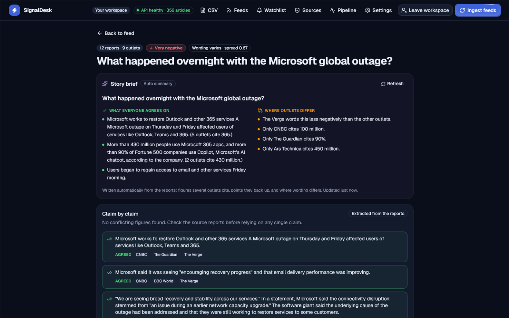
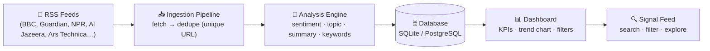

# ⚡ SignalDesk

> **AI-powered news intelligence, on autopilot.**
> SignalDesk pulls news from RSS feeds around the web, deduplicates it, scores sentiment, classifies topics, and surfaces it all in a real-time intelligence dashboard.

     

---




---

## What it does



Every article that enters the system is automatically:

- **Scored for sentiment** in `[-1.0, +1.0]` with negation and intensifier handling
- **Classified** into one of 6 topics (Technology, Business, Science, Politics, Health, World)
- **Summarized** with an extractive summary
- **Tagged** with extracted keywords
- **Deduplicated** by URL, so re-running ingestion never creates duplicates

And the platform runs itself: a built-in scheduler re-ingests every feed every 15 minutes — no cron, no external workers.

## Highlights

| | |
|---|---|
| 📡 **Live RSS ingestion** | Pull from any RSS feed with one click — 110 real articles in under 2 seconds |
| 🤖 **Auto-pilot scheduler** | Background task re-fetches every feed on a configurable interval; feeds report health status ("ok: 5 added · 2h ago") |
| 📄 **Full-text summaries** | Each article's external link is fetched and parsed into a skimmable brief — TL;DR, key points, key numbers, quotes, and bottom line — so you get 90% of the story without opening the site |
| 🖼️ **Real lead images** | Each article's reader page shows the lead image (`og:image`) from its real page, and every card shows the story's true domain with a "verify at the source" link in the reader — a quick legitimacy check. Images are hotlinked and vanish cleanly if a site blocks them |
| 📰 **Stories, best-informed first** | Reports of the same event from different outlets are grouped into one card (word-overlap similarity within a time window). The lead report is the one that carries the most real information, and the other reports sit under "N more reports" in the same order. A switch turns grouping off for a flat list |
| 📖 **Article reader page** | Clicking an article opens a dedicated reader at `/#/article/{id}`: the straightforward summary up top, then skimmable sections (key points, numbers, quotes, bottom line) with chip navigation |
| 🌗 **Light & dark themes** | Accessible triadic color system (blue/green/violet) with a settings menu — both themes verified WCAG AA programmatically |
| 🌡️ **Plain-language sentiment** | Scores read as "Very negative … Very positive" (number on hover), the reader has a labelled −1 / 0 / +1 gauge, and an ⓘ explainer says what sentiment does and does not mean |
| 🧩 **shadcn/ui · Magic UI · Motion** | The dashboard is a React + Vite + TypeScript + Tailwind app built from real shadcn/ui components (card, dialog, sheet, popover, tooltip, hover-card, select…), Magic UI effects (number ticker, blur-fade, border beam, shimmer button) and Motion page transitions, with `prefers-reduced-motion` respected |
| 🧘 **Compact mode** | A one-switch "calm" mode: hides side panels, charts, and chips, and shows fewer articles — for when the dashboard feels overwhelming |
| 📱 **Mobile-first UI** | Designed for phones first: bottom-sheet menu, touch-sized targets, responsive 2-up → 5-column stats, then desktop |
| 🧠 **Zero-dependency NLP** | Deterministic lexicon-based analysis that works offline, with an optional LLM upgrade |
| ☀️ **Daily Brief** | Auto-generated intelligence headline + most positive/negative signals, refreshed with the stats |
| 📊 **Intelligence dashboard** | KPI cards, 7-day sentiment trend, topic breakdown, keyword chips, article reader with sentiment gauge |
| 🔍 **Search, filter & sort** | Live search, source/topic/sentiment filters, newest/oldest/most-polarized sorting, and "load more" pagination |
| 📤 **CSV export** | One click exports the full article dataset |
| 🔒 **Production hardening** | Security headers, env-driven CORS, ingest cooldown + lock, global error handler, feed URL scheme validation, structured health endpoint with version/uptime |
| 🗄️ **Zero-config persistence** | SQLite by default, PostgreSQL with one environment variable; automatic column migrations on startup |
| 🌱 **Real-article seeding** | First boot ingests the real default feeds so every article has a genuine URL; built-in sample articles are only used when the network is unreachable |
| 🤖 **Optional LLM analysis** | Set `LLM_ENABLED=true` with any OpenAI-compatible endpoint (OpenAI, Ollama, LM Studio…) for written TL;DRs and "why it matters"; falls back to the offline analyzer on any failure |
| ✉️ **Brief delivery** | Send the daily brief to Slack and/or email from the dashboard, or on a schedule (`DIGEST_HOUR`) |
| 🔒 **Private workspaces** | Each visitor can open their own workspace: their own feeds, watchlist, ingests and articles, invisible to everyone else, on top of the shared news. No sign-up; data is deleted after `WORKSPACE_TTL_DAYS`. A one-click demo tour of the shared data sits beside it |
| 🔑 **Optional API token** | Set `API_TOKEN` to require `X-API-Key` on all write endpoints; the UI has a field for it |
| 📡 **15 curated feeds** | BBC (World, Technology, Business, Science, Health), The Guardian, NPR, Al Jazeera, Politico, STAT News, CNBC, Ars Technica, ScienceDaily, The Verge and TechCrunch: free-to-read sources chosen for topic and viewpoint spread. One click adds any that are missing to an existing install |
| 🎯 **Information score** | Every report gets an explainable 0–100 score: depth of the extracted article, figures, quotes and a conclusion, analysis, and completeness. It ignores which outlet wrote it, so it ranks fairly. Page furniture (navigation, paywall and credit lines) is stripped first, and a "Most informative" sort uses it |
| 🧠 **Story page** | `#/story/:id` shows an AI **brief** (what everyone agrees on, where outlets differ; uses your LLM if configured, otherwise a deterministic offline writer), a side-by-side **outlet comparison** (info score, wording spread, first to report, most detailed) and every report ranked |
| 🔖 **Saved & read** | Bookmark any article (Topics → Saved); read articles dim. Stored in your browser, no account |
| 🔔 **Watchlist & alerts** | Follow a word or phrase (optionally a topic and a minimum number of outlets). Matching stories get a badge, you are told after an ingest, and alerts go to Slack/email if configured. Each story alerts once |
| 🔥 **Hot topics** | A category in the Topics list (and the topic filter). It shows the articles from the stories the most outlets are covering right now, ranked by outlets × recency, with the stories listed above the feed so you can open any one of them |
| 📄 **Numbered pages** | Page 1, 2, 3… navigation with a windowed page list instead of an endless "load more" |
| ✅ **Tested** | 88 pytest tests, 34 Vitest tests, and GitHub Actions CI for both the backend and the frontend build |
| 🐳 **One-container deploy** | `docker compose up --build` and you're done |

## Quick start

You need **Python 3.12+** and **Node 20+**.

```bash
git clone https://github.com/<you>/SignalDesk.git
cd SignalDesk

# 1. Backend dependencies
python -m venv .venv
.venv\Scripts\pip install -r backend/requirements.txt   # Windows
# source .venv/bin/activate && pip install -r backend/requirements.txt  # macOS/Linux

# 2. Build the dashboard (once)
cd frontend && npm install && npm run build && cd ..

# 3. Run the server
cd backend
..\.venv\Scripts\python -m uvicorn app.main:app --reload

# 4. Open the dashboard
start http://localhost:8000
```

That's it: the database creates and seeds itself on first boot. No config files, no API keys, no external services.

**Developing the UI?** Run the API as above, then `cd frontend && npm run dev` and open http://localhost:5173. It hot-reloads and proxies `/api` to the backend.

### Docker

```bash
docker compose up --build
# → http://localhost:8000   (data persists in the `signaldesk-data` volume;
#   copy .env.example to .env to configure LLM, Slack, email, API token)
```

The image builds the dashboard in a Node stage, so you don't need Node installed for this route.

## The dashboard

Open **http://localhost:8000** to get:

- **KPI row** — total articles, sources, last-24h volume, average sentiment, sentiment split
- **7-day sentiment trend** — SVG sparkline of daily average sentiment
- **Topic breakdown** — clickable topic distribution bars
- **Signal Feed** — every article with sentiment badge, score, topic chip, clean full-text summary, and 📄 Summary / ↗ Visit actions
- **Article reader** — clicking any article opens a distraction-free reader page with the summary and the full article text
- **Filters** — live search, source, topic, and sentiment filters
- **📡 Feeds manager** — add/remove RSS feeds from the UI
- **⬇ Ingest Feeds** — one-click pipeline run with a live results report

Interactive API docs live at **http://localhost:8000/docs** (Swagger UI).

## API

| Method | Endpoint | Description |
|--------|----------|-------------|
| `GET` | `/api/auth/status` | Whether write endpoints require an API token |
| `POST` | `/api/digest/send` | Deliver the daily brief to Slack / email |
| `GET` | `/api/health` | Service health + row counts |
| `GET` | `/api/stats` | KPIs, sentiment split, topic breakdown, 7-day trend |
| `GET` | `/api/trending` | Hot topics: the stories the most outlets cover right now |
| `GET` | `/api/digest` | Generated daily brief: headline, extremes, topic counts |
| `GET` | `/api/stories` | Grouped feed: one card per event, best-informed report first (same filters as articles, plus `ids=` and `order=info`) |
| `GET` | `/api/stories/{id}` | One story in depth: brief, outlet comparison, ranked reports |
| `POST` | `/api/stories/{id}/brief` | Rewrite the story brief now |
| `GET` `POST` `PATCH` `DELETE` | `/api/watches` | The watchlist (writes need the API token when one is set) |
| `GET` | `/api/articles` | Search/filter/sort/paginate articles (`cluster=<id>` shows one story, `hot=1` the hot stories) |
| `GET` | `/api/articles/{id}` | Article detail (incl. keywords and `related` coverage of the same story) |
| `POST` | `/api/articles/{id}/summarize` | Fetch the linked page and generate a clean full-text summary on demand |
| `GET` | `/api/articles/export.csv` | Download all articles as CSV |
| `GET` | `/api/feeds` | List feeds with last-fetch health |
| `POST` | `/api/feeds` | Add a feed (`{"name", "url"}`) |
| `DELETE` | `/api/feeds/{id}` | Remove a feed |
| `POST` | `/api/ingest` | Fetch all active feeds → dedupe → analyze → store |

## Configuration

| Variable | Default | Purpose |
|----------|---------|---------|
| `DATABASE_URL` | SQLite (`backend/signaldesk.db`) | Point at PostgreSQL for production |
| `APP_ENV` | `development` | `production` for deployments (shown in `/api/health`) |
| `CORS_ORIGINS` | `*` | Comma-separated allowed origins; set explicit origins in production |
| `LOG_LEVEL` | `INFO` | Python log level |
| `INGEST_INTERVAL_MINUTES` | `15` | Auto-pilot re-ingest interval; `0` disables the scheduler |
| `INGEST_COOLDOWN_SECONDS` | `20` | Minimum seconds between manual ingests (429 within the window) |
| `ENRICH_BATCH_SIZE` | `30` | Articles enriched per background wave |
| `SCHEDULER_DISABLED` | `false` | Set `true` in tests/CI to prevent boot-time network calls |
| `MAX_ARTICLE_AGE_DAYS` | `7` | Skip stories older than this (`0` disables) |
| `LLM_ENABLED` / `LLM_API_KEY` / `LLM_BASE_URL` / `LLM_MODEL` | off | Optional LLM analysis via any OpenAI-compatible API |
| `SLACK_WEBHOOK_URL`, `DIGEST_EMAILS`, `SMTP_*` | unset | Brief delivery channels |
| `DIGEST_HOUR` | `-1` | UTC hour for automatic brief delivery (`-1` disables) |
| `API_TOKEN` | unset | Require `X-API-Key` on POST/DELETE endpoints |
| `SESSION_SECRET` | `API_TOKEN` | Signs workspace tokens. Workspaces are off when neither is set |
| `WORKSPACE_TTL_DAYS` | `7` | A workspace's data is deleted after this many days |
| `WORKSPACE_MAX_FEEDS` / `WORKSPACE_MAX_WATCHES` / `WORKSPACE_MAX_ARTICLES` | `8` / `10` / `600` | Per-workspace limits |
| `WORKSPACE_CREATES_PER_HOUR` | `20` | Workspaces one client IP may create per hour |

See [.env.example](.env.example) for a annotated template.

## Project structure

```
SignalDesk/
├── backend/
│   ├── app/
│   │   ├── main.py          # FastAPI app, routes, static serving
│   │   ├── config.py        # Env-driven settings
│   │   ├── llm.py           # Optional OpenAI-compatible analysis
│   │   ├── notifications.py # Slack / SMTP brief delivery
│   │   ├── clustering.py    # Groups duplicate coverage into stories
│   │   ├── quality.py       # Information score (0-100) per report
│   │   ├── stories.py       # Grouped feed, ranking inside a story, outlet comparison
│   │   ├── briefs.py        # Story briefs: LLM writer + offline fallback
│   │   ├── watches.py       # Watchlist matching and alerts
│   │   ├── enrichment.py    # Full-text fetch + structured summaries
│   │   ├── database.py      # Engine + sessions (SQLite → Postgres switchable)
│   │   ├── models.py        # SQLAlchemy models (Article, Feed)
│   │   ├── schemas.py       # Pydantic request/response schemas
│   │   ├── analysis.py      # Sentiment · topics · summary · keywords
│   │   ├── ingestion.py     # RSS fetch → dedupe → analyze → store
│   │   └── seed_data.py     # Demo data auto-seeded on first boot
│   └── tests/               # pytest: analysis unit tests + API integration
├── frontend/                # React + Vite + TypeScript dashboard
│   └── src/
│       ├── components/ui/   # shadcn/ui + Magic UI components
│       ├── components/app/  # Header, feed, sidebar, reader, dialogs
│       ├── hooks/           # Dashboard state, settings, hash routing
│       └── lib/             # API client, sentiment wording, formatters
├── tools/devshots.py        # Screenshot helper (desktop + mobile)
├── .github/workflows/ci.yml # pytest + frontend typecheck/test/build
├── Dockerfile
├── docker-compose.yml
└── pytest.ini
```

## Design decisions

- **Deterministic NLP first, LLM as an upgrade.** The lexicon-based analyzer runs offline and behaves identically on every run, so anyone can clone and try it with no keys. When `LLM_ENABLED` is set, `llm.py` layers richer summaries on top and silently falls back on any malformed or failed response.
- **Deduplication at the storage layer.** URLs are unique-indexed; ingestion is idempotent, so the pipeline can run on a schedule without supervision.
- **Forward-safe migrations.** New columns are detected at startup (`ensure_columns`) and added via `ALTER TABLE`, and existing rows are backfilled (e.g. keyword computation) — upgrading a running deployment never breaks it.
- **A real component stack for the UI.** shadcn/ui gives accessible primitives (Radix/Base UI under the hood), Magic UI and Motion add restrained polish, and the API stays a plain REST contract so the frontend is replaceable. FastAPI serves the built files, so production is still one container.
- **Plain-English sentiment.** All labels, thresholds and explanations live in `frontend/src/lib/sentiment.ts` (unit-tested), so the wording can't drift between the feed, the reader and the explainer.
- **SQLite-first.** The default needs zero infrastructure; `DATABASE_URL=postgresql://…` is the only change required for Postgres.

## Testing

```bash
.venv\Scripts\python -m pytest -q      # backend
cd frontend && npm test               # frontend (Vitest)
```

## Roadmap

- [x] Live RSS ingestion with URL deduplication
- [x] Sentiment, topic, summary & keyword analysis
- [x] Scheduled background ingestion
- [x] Daily intelligence brief
- [x] CSV export
- [x] LLM-backed analysis backend (optional, OpenAI-compatible)
- [ ] Keyword/entity highlighting in article summaries
- [x] Email/Slack digest of daily signals
- [ ] Auth + multi-user workspaces

## License

MIT — see [MIT-LICENSE.txt](MIT-LICENSE.txt).

## Deploying on Vercel

1. Add a Postgres database (Vercel dashboard, Storage, Marketplace, Neon). It sets `DATABASE_URL` for you.
2. In Settings, Environment Variables, add `APP_ENV=production`, `SCHEDULER_DISABLED=true`, `API_TOKEN`, `CRON_SECRET` (random strings) and `CORS_ORIGINS` (your Vercel URL).
3. Deploy with `vercel --prod`. `vercel.json` deploys the `backend` (FastAPI) and `frontend` (Vite) as two services on one domain, routes `/api/*` to the backend, and `/api/cron/ingest` runs the scheduled ingest.

### Workspaces and the demo

With `API_TOKEN` (or `SESSION_SECRET`) set, the landing page offers **Open my workspace**: a private copy of the app's write features. A visitor's feeds, watchlist, alerts and articles are stamped with a signed workspace id and are invisible to every other visitor; the shared, cron-ingested news stays visible alongside. Workspaces are deleted after `WORKSPACE_TTL_DAYS` by the same cron that ingests the shared feeds.

Because strangers can add feed URLs, the server fetches them through an SSRF guard (public http(s) addresses only, every redirect checked, responses size-capped), caps each workspace, rate-limits workspace creation per IP, and keeps these owner-only: Slack/email delivery, the recommended-feeds reset and LLM-backed actions. Visitor alerts are shown in their dashboard and never sent to your channels.

Set `DEMO_MODE=true` for the **demo tour** next to it: a 2-hour token that can run ingests on the shared data but cannot edit anything. The real `API_TOKEN` is never shared.

**Upgrading an existing database:** the first boot of this version makes feed names/URLs and article URLs unique per workspace instead of globally. SQLite tables are rebuilt automatically (rows are kept). On PostgreSQL the old unique constraints are dropped and composite unique indexes created. It is idempotent, but back up a production database before the first deploy.

Vercel Hobby only allows daily cron jobs, so `vercel.json` runs one ingest a day as a safety net and `.github/workflows/ingest.yml` calls the app every 15 minutes. Add the repository secrets `APP_URL` (your Vercel URL, no trailing slash) and `CRON_SECRET` (same value as in Vercel). On Pro you can drop the workflow and set the cron to `*/15 * * * *`.
